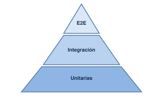

>**¿Por qué necesitamos el testing?**

# ✅ Fundamentos y testing automatizado

Imaginemos que desarrollamos una aplicación para gestionar pedidos. El código calcula el importe multiplicando el precio por la cantidad de productos. Si el usuario compra tres unidades de un producto que cuesta 10€, el resultado debería ser 30€.

Pero, ¿qué ocurre si la cantidad es negativa? ¿y si es cero? ¿y si llega el texto `tres`en lugar de un número?

El código puede ejecutarse sin producir un error técnico, y aún así, generar un resultado incorrecto desde el punto de vista de negocio.

La idea que debemos entender es esta:

> Que un programa se ejecute sin errores no significa que se comporte correctamente ni que sea seguro.


>**El testing consiste en comprobar de manera sistemática si un sistema se comporta como esperamos bajo determinadas condiciones**

## Error humano, defecto y fallo

Es útil distinguir tres conceptos:

- **Error humano**: una persona toma una decisión equivocada o escribe una instrucción incorrecta.
- **Defecto**: el error queda incorporado al código, al diseño o a la configuración.
- **Fallo**: el sistema muestra un comportamiento incorrecto cuando se ejecuta en determinadas condiciones.

Ejemplo: Un desarrollador olvida comprobar que la cantidad de un pedido sea positiva. Ese olvido es un error humano; la ausencia de validación es un defecto; aceptar un pedido con cantidad negativa es un fallo observable.

## Verificacion y validación

Aunque estén relacionadas, responden a preguntas distintas:

| Concepto | Pregunta | Ejemplo |
|---|---|---|
| Verificación | ¿Estamos construyendo el producto de acuerdo con las especificaciones? | Comprobar que una función calcula el importe correctamente. |
| Validación | ¿Estamos construyendo el producto adecuado para la necesidad real? | Comprobar que las reglas de pedidos responden a las necesidades del negocio. |

Una aplicación puede superar pruebas técnicas y cumplir literalmente una especificación, pero esa especificación puede ser insuficiente. Por ejemplo, el sistema puede calcular bien los importes y no contemplar que un usuario no autorizado intente modificar un pedido.

## Tipos de pruebas: la pirámide de testing



- **Pruebas unitarias**: comprueban una unidad pequeña de código, como una función.

- **Pruebas de integración**: comprueban que varios componentes funcionan correctamente juntos.

- **Pruebas E2E (end-to-end)**: verifican un flujo completo desde el punto de vista del usuario, por ejemplo, iniciar sesión y consultar un pedido.

¿Por qué no hacer solamente pruebas E2E? Porque suelen implicar más componentes, son más lentas y, cuando fallan, puede resultar más difícil localizar la causa. Las pruebas unitarias son normalmente más rápidas y específicas.

## Diseño de casos de prueba

Antes de enseñar una herramienta, conviene enseñar a pensar como tester. Automatizar una prueba mal diseñada solo permite repetir rápidamente una comprobación insuficiente.

Un **caso de prueba** describe una situación concreta que queremos comprobar, incluyendo las condiciones iniciales, los datos utilizados y el resultado esperado.

| Elemento | Significado |
|---|---|
| Identificador | Código único del caso de prueba |
| Entrada | Datos que recibe la función |
| Resultado esperado | Comportamiento correcto según los requisitos |
| Resultado real | Lo que sucede al ejecutar el programa |
| Estado | Superada o fallida |
| Evidencia | Salida de la herramienta, registro o captura |

Ejemplo de requisito:

>El sistema sólo debe aceptar cantidades enteras positivas para un pedido.

| Caso | Entrada | Resultado esperado |
|---|---|---|
| CP01 | `3` | Aceptar |
| CP02 | `1` | Aceptar |
| CP03 | `0` | Rechazar |
| CP04 | `-2` | Rechazar |
| CP05 | `1.5` | Rechazar |
| CP06 | `"tres"` | Rechazar |

>¿Qué otras entradas se os ocurren?

¿Qué pasaría con `null`, un valor excesivamente grande, o una cadena vacía?

## Primer contacto con Vitest

### ¿Qué es Vitest?

Vitest es un framework de testing para JavaScript. Proporciona herramientas para organizar pruebas, ejecutar funciones, comparar resultados y mostrar qué comprobaciones han pasado o fallado.

No sustituye al código de la aplicación. Lo ejecuta en el contexto de las pruebas y permite comprobar si su comportamiento coincide con lo esperado.

En esta unidad utilizaremos tres elementos:

- `test()` o `it()`: define una prueba.

- `expect()`: expresa qué resultado esperamos.

Un matcher, como `toBe()`: compara el resultado real con el esperado.

Por ejemplo:

```js
import { test, expect } from 'vitest';

test('dos más dos es cuatro', () => {
  expect(2 + 2).toBe(4);
});
```

La prueba pasa si la expresión evaluada produce el resultado esperado. Si se cambia el 4 por 5, la prueba falla.

### Preparar el proyecto

Como requisito necesitamos **tener Node.js instalado y VSCode**

En el terminal:

```bash
mkdir ud2-testing
cd ud2-testing
npm init -y
npm install --save-dev vitest
```

En el archivo `package.json`, añade `"type": "module"` y el script `test`. Conserva las dependencias que haya generado npm.

Una configuración mínima sería:

```json
{
  "type": "module",
  "scripts": {
    "test": "vitest run"
  },
  "devDependencies": {
    "vitest": "^3.0.0"
  }
}
```

>La versión del ejemplo es ilustrativa: al instalar Vitest, es preferible conservar la versión que npm haya instalado en lugar de copiar una versión antigua a mano. No sustituyas el `package.json` completo si el proyecto ya contiene otras dependencias.

### Crea los archivos

Vamos a formar esta estructura:

```txt
ud2-testing/
├── package.json
├── pedido.js
└── pedido.test.js
```

`pedido.js`

```js
export function validarCantidad(cantidad) {
  return Number.isInteger(cantidad) && cantidad > 0;
}
```

`pedido.test.js`

```js
import { test, expect } from 'vitest';
import { validarCantidad } from './pedido.js';

test('acepta una cantidad positiva', () => {
  expect(validarCantidad(3)).toBe(true);
});

test('rechaza una cantidad negativa', () => {
  expect(validarCantidad(-2)).toBe(false);
});
```

Ejecuta: 

```bash
npm run test
```

Vitest debe mostrar dos pruebas superadas.

El archivo `.test.js` contiene las comprobaciones, mientras que `pedido.js` contiene la funcionalidad que queremos verificar.

### El patrón Arrange-Act-Assert

Una buena prueba suele tener tres fases:

- **Arrange**: preparar los datos y las condiciones.

- **Act**: ejecutar la funcionalidad.

- **Assert**: comprobar el resultado.

En nuestra prueba:

```js
test('acepta una cantidad positiva', () => {
  // Arrange
  const cantidad = 3;

  // Act
  const resultado = validarCantidad(cantidad);

  // Assert
  expect(resultado).toBe(true);
});
```

# ❌ Pruebas negativas y límites de entrada

## Pruebas positivas frente a pruebas negativas

Una **prueba positiva** comprueba que el sistema acepta una entrada válida y produce el resultado esperado.

Una **prueba negativa** verifica que el sistema rechaza una entrada no válida o responde de forma controlada ante una situación inesperada.

| Tipo      | Entrada                      | Comportamiento esperado                                      |
|-----------|------------------------------|--------------------------------------------------------------|
| Positiva  | Un precio de 80 €            | Calcula el resultado correcto.                               |
| Positiva  | Un cliente de tipo premium   | Aplica la regla de descuento correspondiente.                |
| Negativa  | Un precio negativo           | Rechaza la entrada.                                          |
| Negativa  | Un precio como texto         | Rechaza la entrada si se exige un número.                    |
| Negativa  | Un tipo de cliente desconocido | No aplica reglas por defecto sin control.                  |
| Negativa  | `NaN` o `Infinity`           | Rechaza valores que no representan importes válidos.        |

> Una **prueba negativa o no tiene por qué terminar en una excepción**. Puede comprobar que la función devuelve un error controlado, que rechaza la operación o que responde con un código HTTP apropiado. Lo importante es que el comportamiento sea el esperado.

## Cómo elegir casos de prueba sin probar todas las posibilidades

No es viable probar todas las entradas posibles. Para seleccionar casos útiles, vamos a utilizar dos técnicas.

**Partición de equivalencia**. Agrupamos entradas kque deberían comportarse de la misma manera y elegimos representantes de cada grupo.

Por ejemplo, si una aplicación acepta importes iguales o superiores a cero:

- Importes válidos: `0, 25, 100`.
- Importes negativos: `-1, -100`.
- Valores que no son números: `"25", null, undefined`.
- Valores numéricos no finitos: `NaN, Infinity`.


No hace falta probar todos los valores que comparten la misma regla, aunque conviene elegir suficientes ejemplos para detectar errores relevantes.

**Análisis de valores límite**. Comprobamos especialmente los extremos de una regla, porque es frecuente que los defectos aparezcan al usar operadores incorrectos.

Si el descuento se aplica a partir de 100€, los casos importantes son:

- `99.99`: no debe aplicarse
- `100`: debe aplicarse
- `100.01`: debe aplicarse

Ese análisis ayuda a detectar, por ejemplo, que alguien haya escrito `>` en lucar de `>=`.

## Las aserciones también comprueban errores

Con Vitest, podemos verificar tanto el resultado correcto como el rechazo de una entrada.

```js
import { expect, test } from "vitest";

test("rechaza un importe negativo", () => {
  expect(() => calcularTotal(-10, "standard"))
    .toThrow();
});
```

En este ejemplo no comprobamos solamente que algo falla: especificamos que la función debe lanzar una excepción. En otros diseños, la función podría devolver un resultado de error y la aserción sería distinta.

La prueba debe reflejar el contrato que hemos definido para la función, no adaptarse a cualquier comportamiento que produzca el código.
